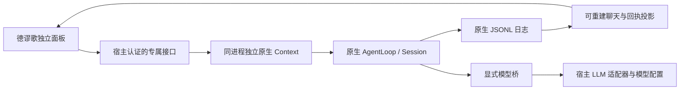

# 最小原型与验收

本文为记忆模块之前的原型阶段记录，空工具集等表述只描述该阶段。后续记忆首版、受限工具、分段和压缩的当前状态见 [模块说明](../src/core/memory/README.md)。

日期：2026-11-06。实现位置：`E:\works\LiveSeed`。验证基线：DSH `0.2.0-rc.2`、Cordis `4.0.5`、Node `22.23.3`、pnpm `11.25.0`。

范围澄清：本文验收的是工作区归属、模型桥及当前空工具集的边界。记忆写入、状态、调度、授权策略尚未实现，不能宣称其与主模型的隔离已经验收；纠正后的职责边界见 [记忆模块讨论稿](05-记忆模块讨论稿.md)。

## 当前方案

独立 Context 是插件内部的服务容器，不是另起的 DSH、SDK 或后台进程。它安装 Harness 原生运行组件，使用原生上下文组装和日志恢复；没有另写一套对话运行时。独立性来自服务所有权与显式接入。

宿主普通 Session 服务、查询索引和控制器不持有这份 Session。客户端只注册全局「德谬歌」导航入口和独立主面板，不增加工作区聊天条目。面板 API 只操作插件持有的唯一会话，调用方不能指定 Session ID。

## 日志与上下文

- `stateDir/sessions` 使用原生 JSONL persistence，当前固定会话 ID 为 `liveseed-main`，不指定工作目录。
- 输入通过原生 `agent.followup` 写入；用户消息的 source 携带发送 UUID。输出和中止使用原生事件。
- `liveseedTranscript` 是原生 projection：从消息、inbox、attempt 和 turn 事件重建聊天、停止提示与发送回执。当前面板显示最近 200 条；原生日志不按这个窗口删除。
- 发送确认前调用原生 flush，结束时再次 flush。重复 UUID 与相同内容返回已有消息 ID，重启后仍有效；相同 UUID 更换内容会被拒绝。
- 取消会保留原生日志中的部分回复。瞬时流式文本只用于显示，不是另一份持久事实。
- 当前沿用原生上下文组装，尚未接入自动压缩、记忆检索、遗忘或自传策略；面板 200 条窗口不是模型上下文裁剪规则。

## 模型与能力

默认读取 DSH 的默认模型选择；可在插件配置中同时指定 `provider` / `model`。原生 agent 使用本机版本支持的 `installModelSelection`。每次回复锁定此次选择，模型桥通过宿主 `llm.prepareCall` 取得适配器，不复制密钥，不引入独立模型配置库。

模型桥只允许当前选择的路由，保留原生模型可见消息，剥离私有 Session ID 元数据。当前模型输出上限默认 512 tokens，回复超时默认 90 秒，可在配置范围内调整。

私有容器不安装宿主文件、Shell、浏览器等能力，工具 schema 为空，原生 tools guard 拒绝工具执行；桥也拒绝带工具集合的调用。后续引入工具前需要设计明确的宿主授权桥。独立 Context 本身不是 OS 沙箱。

面板三个接口均调用宿主 `connection.admit`，复用登录认证，并要求自定义请求头。输入有严格 schema、长度和请求体限制，禁止夹带 Session ID；错误响应不暴露供应商异常或密钥。

## 已验收

`pnpm check`：

- 类型检查、服务端与前端构建、真实 Cordis loader 加载 / 卸载与配置拒绝。
- 原生 Session / JSONL / projection 下发送、模型桥、持久化幂等重试、重启恢复、并发拒绝、流式停止及故障后继续。
- 宿主 Session / persistence / SQLite 查询不包含私有会话；即使合成模型返回 `read` 调用，宿主同名哨兵工具执行次数也为零。

`pnpm test:browser` 使用本机完整 DSH CLI、隔离 `DSH_HOME`、临时端口和 Edge：

- 官方 Web profile 实际加载客户端插件；打开面板、发送、显示回复、停止，浏览器无未捕获异常。
- 关闭开发宿主再启动，恢复此前聊天；桌面与窄屏布局已检查。
- 未登录访问被拒绝；已登录但缺少面板请求头返回 403，夹带其他 Session ID 返回 400。
- 调用原生 `session/list`、`session/search`，确认 RPC 本身成功且结果不包含私有会话。搜索使用已写入私有对话的独特文本。

上述测试全部使用合成模型，真实模型调用次数为零；证明宿主接入链路，不代表已经验收真实供应商。机器可读记录见 [验收结果](validation/liveseed-prototype-2026-11-06.json)，[桌面预览](validation/liveseed-desktop.png) 仅含合成对话。

## 使用与后续边界

构建、测试与加载命令见仓库 [README](../README.md)。当前包版本 `0.0.1`，bundle 默认禁用，需要配置绝对 `stateDir` 后启用。开发覆盖层与包安装不要重复启用，同一日志目录只允许一个实例写入。本次未改全局 DSH 安装、现用 profile 或已有会话。

这份原型解决了原生上下文复用、专有会话归属和 UI 接入的可行性问题。尚待决定长期记忆、上下文压缩、人格演进、主动表达和时间触发策略；没有引入这些机制。超长上下文、非正常关机、供应商差异、跨版本迁移及多设备同步不在此次验收范围。

## 接口参考

- [官方 Super-agent 客户端 slot 接入](https://github.com/deepseek-ai/dsh-superagent-prototype/blob/main/src/client/index.tsx)
- [官方 Super-agent 客户端模块构建](https://github.com/deepseek-ai/dsh-superagent-prototype/blob/main/tsdown.config.ts)
- [前期原生 Session / Context 接口实验](03-Session与Context验证.md)

在线主分支可能变化，实际运行以本机锁定依赖和类型声明为准。
