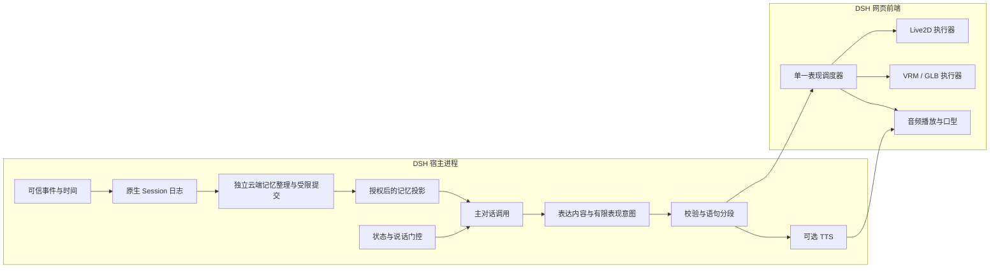

# 网页角色展示与驱动方案

日期：2026-11-06。状态：讨论稿，未实现。用户确认目前没有可用角色文件，先确定架构。角色显示在 DSH Web 前端，不新增独立角色应用或常驻宿主。

最新范围（2026-11-07）：用户已提供本地 PMX 模型，静态检查见 [15](15-本地角色模型检查与MMD适配.md)，原生常驻舞台首版现已实现并完成真实模型基础验收，见 [19](19-PMX常驻舞台首版与验收.md)。以下早期 VRM / Live2D 分工保留为历史方案，当前实际支持范围以 19 与模块说明为准。

## 分工

宿主内插件负责对话、记忆、状态、说话门控、表达意图校验和必要的语音合成请求。浏览器负责角色资源加载、Canvas / WebGL 渲染、动作调度、音频播放、口型及逐帧更新。模型 API 和 TTS 服务凭据保留在宿主侧。

按 2026-11-07 用户最新要求，舞台应挂到 DSH 根级 `shell.overlay`，在普通工作区也常驻，不再依附聊天 React 面板。背景透明并沿用 DSH 主题，支持移动、调整大小与隐藏；默认点击穿透，只由显式控件接收操作。当前宿主的插槽证据、生命周期与动作制作流程见 [16](16-AIRI接入与动作来源调研.md)。

## 之前讨论的项目确实涉及什么

复查了 `E:\otherWork\docs\2026-11-01-陪伴AI角色展示与动作系统` 下的原有分析、本地固定源码和上游官方资料。以下均为文档 / 源码核对，未在本轮启动这些应用、下载模型或比较视觉效果。

| 项目 | 浏览器与角色路径 | 对 LiveSeed 的借鉴与限制 |
|---|---|---|
| AIRI | 有独立 stage-web；共享 Vue 舞台，Live2D 使用 Pixi 相关运行时，VRM 使用 Three.js 相关组件 | 参考动作 / 表情注册表、通道控制权、语音口型同步、待机驱动；其 Vue / Pinia 整套产品层不直接嵌入当前 React 插件 |
| AITuberKit | Next.js / React Web 应用，VRM 使用 Three.js + three-vrm，Live2D 使用 Pixi 适配 | 参考分句、播放队列、姿态淡入淡出和音频驱动嘴型；内置 API / stores 与整套产品耦合，不因为同为 React 就可直接复制为插件 |
| HAST-SEC | 浏览器使用 Three.js / VRM，动作轨道与约束求解在其网页执行链中；自带 Node 与本地语言推理服务 | 参考局部骨骼动作和轨道混合；不是可直接加载的纯前端组件，现有服务接口也不是现成的外部动作执行入口；不直接支持 Live2D |
| Amica | 官方列出 Three.js / three-vrm，支持导入 VRM 与语音、情绪表现 | 可参考三维对话角色的面部与口型路线，不据此推定有参数化四肢控制 |
| Open-LLM-VTuber | 有 Web 使用模式，主要角色路线为 Live2D，并有表情、语音与打断 | 可参考 Live2D 语音交互，不将其视为 VRM 全身动作执行器 |

本地源码基准：AITuberKit `91890921e8624001ce1d04a0f59759e1ab5ee334`；AIRI `259b6188a7209a46bd535fa011340486654da8df`；HAST-SEC `f4d5c9aa32f9d04e249585e0b2e6d4c56572ca51`。Amica / Open-LLM-VTuber 本轮仅核对官方 README，未检查其完整执行链。

核对得到的具体差异：

- AITuberKit 的 VRM 可以消费 `motion` 对应的姿态 / 序列；所读 Live2DHandler 主要将 emotion 映射为表情与动作组，不能认为相同 motion 标签跨两种角色自动等价。
- AIRI 所读 Stage 的显式 ACT motion / expression 文件分支用于 Live2D；VRM 分支主要处理情绪映射。不能把一个格式的能力直接推给另一格式。
- AIRI 的 MAGIC 用参考数据拟合 VAR / AR-HMM 并生成持续运动帧，可参考自然小动作；不是浏览器凭任意中文生成完整三维动作的保证。

因此借用的是分层方式与局部机制，接入仍由 LiveSeed 的前端执行器完成。项目、SDK、角色和动作资源的许可分别核对；不把第三方样例模型随本插件默认分发。

## 表现协议

模型输出有限语义，例如 `smile`、`nod`、`wave`、视线目标，以及对应的台词片段。模型不输出可执行 JavaScript、资源 URL、Live2D 参数名或任意骨骼数值。

表达协议只允许当前角色能力表中的标识与有界强度 / 时长。后端校验意图，前端执行器再依据所加载角色核对能力。控制标记与台词分离，不显示为聊天正文，也不送入 TTS 朗读；流式解析必须等完整标记校验后才能执行。

语义标识不等于绑定任何模型都能执行：

- Live2D：`smile` 映射 `.exp3.json` 或明确参数配方，`nod` 映射可用 `.motion3.json` / 动作组。
- VRM：映射 expression 通道、VRMA / AnimationClip 或经过验证的人形程序动作。
- 普通 GLB：映射其自带动画与 morph target / 自定义节点；不假定有人形骨骼。
- 不支持的动作回报 unsupported 或按显式配置降级，不凭模型编造文件名加载资源。

可以允许角色交互触发同样的有限意图。模型可见的是语义能力清单，素材细节由执行器与角色清单负责。

## 单一调度器与通道

每个舞台由一个调度器管理播放顺序、取消、淡入淡出与通道所有权；允许不冲突的通道叠加，不是让所有动作完全串行。

| 通道 | 建议的输入与控制权 |
|---|---|
| 待机 / 呼吸 | 本地程序或角色待机动画持续运行，没有语义事件就不调用云模型 |
| 视线 | 光标或语义目标映射，主动动作临时接管后归还 |
| 眼睛 | 眨眼与显式闭眼 / 表情协调，避免两个驱动同时写同一参数 |
| 面部表情 | 有限意图与当前可表现状态映射，限制强度并渐变 |
| 口型 | 实际正在播放的音频或其音素时间，不能按 token 抵达频率张嘴 |
| 身体动作 | 可用资源 / 程序动作，按优先级替换或分层混合 |

后台记忆整理不占用表达通道，也不因为输出 JSON 或日记就触发角色说话。视觉微笑不会反向赋值为 `valence` 上升；表现层不能修改记忆、状态、时机门控或授权。

## 语音、打断与同步

台词按句 / 片段形成播放单元，携带回复 ID、片段序号和运行代际；语音、动作与表情引用同一片段。第一版可用音频幅度驱动张合，后续再增加音素 / viseme 对齐。没有 TTS 时仍可显示角色、表情和动作，不假装文字流是音频口型。

用户停止时取消当前生成、未播放语音及动作队列，正在播放的音频停止，嘴型复位，姿态按配置回到待机；迟到的上一代结果不得重新播放。语音和动作的排序由执行器实现，不能靠模型自己计时。

传输使用已认证的原生 Remote / Gateway 连接，增量事件需支持序号 / 去重；当前聊天已有原生通信，但尚未实现音画同步协议。刷新或重连恢复状态，不自动把历史发言重新朗读。多个标签页不能同时取得同一回复的自动播放权，需定义当前舞台的播放归属。

意图已产生、语音已合成、浏览器报告已播放是不同事实，记录时应区分。只把有产品意义的结果写入 Session，不记录每帧骨骼或每次眨眼；前端播放回执也不证明世界里发生了额外经历。

## Live2D 与 3D 如何选择

| 方向 | 适用条件 | 资源与执行要求 |
|---|---|---|
| Live2D | 重视二维画风、固定角度与脸部表现 | 完整模型包、绑定参数、纹理、表情和动作；Cubism Web / Core 及适配层版本需一起验证 |
| VRM 3D | 人形角色、需要转身 / 镜头变化 / 全身动作 | 人形映射、表情与动作资源、Three.js + three-vrm；实际骨架和重定向效果验收 |
| GLB / glTF 3D | 种子、花朵或其他非人形形态 | 自有动画与形变映射，Three.js；不能照用 VRM 人形专用驱动 |

早期讨论时暂无角色文件；当前已收到 PMX 素材，建议以 MMD 执行器验证，详见 [15](15-本地角色模型检查与MMD适配.md)。保留“网页舞台 → 调度器 → 格式执行器”分工，不同时制作两套完整引擎；不预先引入 MAGIC 等高级运动机制。

## 浏览器生命周期

- 舞台可见时才维持所需渲染频率，用户隐藏角色或标签页隐藏时暂停渲染 / 物理；切换工作区或聊天面板不卸载舞台。页面卸载或插件停用时释放 renderer、纹理、几何体、事件和 AudioNode。恢复时限制过大帧间隔，不追赶停留期间的所有旧动作。
- 浏览器可能暂停后台页面的 requestAnimationFrame；后端记忆和时间机制不能依赖浏览器渲染循环。网页关闭后不继续渲染，但宿主若仍运行可继续允许的整理任务。
- 音频可能需要用户手势解锁，不能承诺打开页面就能自动出声；TTS 失败时保持文字可用。
- 控制像素比、纹理、帧率和同时可见角色数，用目标素材实际测量占用，不预设 Live2D 一定比 3D 轻。
- 模型资源作为资源提供，不作为任意脚本执行入口。开发样例与产品角色分开，模型素材不进入 Git 默认提交。

## 首次验证范围

在 DSH 根级浮层验证：加载、待机、表情、一个可用动作、可选音频口型、停止与重连；切换工作区 / 面板后保持单个舞台，页面卸载后资源释放。再验证角色不支持动作时的降级、两个驱动抢同一通道时的仲裁，以及后台整理不会误触发播放。

这些是待实现的验收项。本轮没有安装渲染依赖、导入角色或修改运行代码。

## 来源

- [原有角色展示分析](E:/otherWork/docs/2026-11-01-陪伴AI角色展示与动作系统/AITuberKit与AIRI展示机制分析.md)
- [原有 HAST-SEC 比较](E:/otherWork/docs/2026-11-01-陪伴AI角色展示与动作系统/HAST-SEC-integration-comparison.md)
- [AIRI 官方仓库与 stage-web](https://github.com/moeru-ai/airi)
- [AIRI 固定版本 Stage](https://github.com/moeru-ai/airi/blob/259b6188a7209a46bd535fa011340486654da8df/packages/stage-ui/src/components/scenes/Stage.vue)
- [AITuberKit 固定版本 Live2DHandler](https://github.com/tegnike/aituber-kit/blob/91890921e8624001ce1d04a0f59759e1ab5ee334/src/features/messages/live2dHandler.ts)
- [AITuberKit 固定版本依赖](https://github.com/tegnike/aituber-kit/blob/91890921e8624001ce1d04a0f59759e1ab5ee334/package.json)
- [HAST-SEC 官方仓库](https://github.com/sola1039/HAST-SEC)
- [Amica 官方 README](https://github.com/semperai/amica/blob/master/README.md)
- [Open-LLM-VTuber 官方 README](https://github.com/Open-LLM-VTuber/Open-LLM-VTuber/blob/main/README.md)
- [Cubism SDK for Web](https://docs.live2d.com/en/cubism-sdk-manual/cubism-sdk-for-web/)
- [three-vrm 官方示例](https://github.com/pixiv/three-vrm)
- [Chrome 音频自动播放策略](https://developer.chrome.com/blog/autoplay)
- [requestAnimationFrame](https://developer.mozilla.org/en-US/docs/Web/API/Window/requestAnimationFrame)
