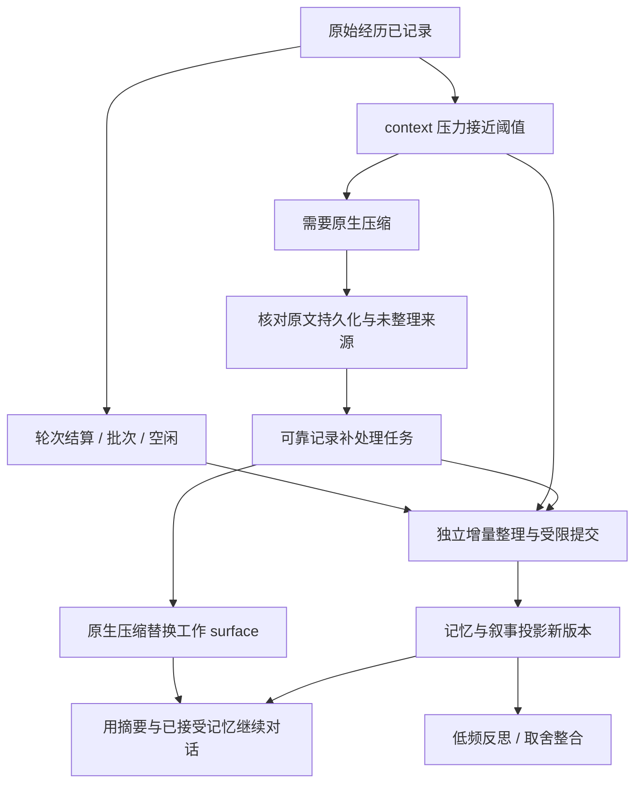

# 记忆取舍、运行时机与上下文压缩

实施更新：已接入原生 token meter / compaction-basic，由私有 Agent 作用域在来源保存后触发压力检查与最多一次溢出恢复；具体实现与验收见 [记忆模块说明](../src/core/memory/README.md)。本文保留设计依据。

日期：2026-11-06。状态：设计讨论，未实施。本轮仅更新文档；Live2D / 3D 搁置，只预留接口边界。本文补充 [记忆模块方案](05-记忆模块讨论稿.md)。

最新行为约束见 [10](10-Context状态与工作输入触发.md)：状态依赖 context，不建立独立数值状态；任何整理、反思和日记任务完成都不直接触发发言。主动表达只在普通工作区 prompt 接收后 15 秒的窗口判断。

用户后续修正：以昔涟背景下温和的日常陪伴为场景基线，不用严重争执作为常规例子。主动遗忘由独立整理线发起与处理，不要求主线先说出“我要忘记 / 放下”，减少在对话中表演记忆机制。

Session 默认按天分段及跨段连续性的生命周期方案已获用户同意，见 [分段方案](08-长期身份与Session分段.md)。分段不能代替段内压缩，也不能重置跨段记忆或主动遗忘状态；功能尚未实现。

## 用户引用内容应落实到哪里

依据 `E:\works\NlpForAmphoreus\docs\德谬歌\01-想法记录-2026-10-27.md` §12–15。这些内容不只是文案，也约束记忆系统的目标和默认行为。此前方案提到了取舍，但没有把它与压缩、反思职责和触发时机充分区分。

| 原文取向 | 方案中的对应 |
|---|---|
| §12 互补的见证、间断存在与可延续记忆 | 保留经历原文、来源与可读交接，恢复后能接上已经发生的过去；不补写停机时未发生的生活 |
| §13 记住与忘却中的选择 | 原始经历默认保留；召回权重、保护、封存和取舍记录独立维护。存储压力与上下文缩短不构成她“决定放下”的证据 |
| §14 人设体现于取舍 | 保留她在不同时间怎样看待同一件事、为什么留下或放下；叙事从有依据的取舍形成，不由整理器统一改成性格形容词 |
| §15 允许受经历影响与保留矛盾 | 整合不以抹平矛盾、永远积极或恢复成预设人格为目标；不确定、未决定和改变看法都可有版本。原文的创伤与修复问题仍属未决叙事议题，不转成故意删记忆或制造创伤的工程规则 |

原文的“记忆可以完美”在工程上先落实为原文可保存、可回溯，不许宣称抽取、检索与每次回忆绝不出错。保存事实不等于每轮全量注入。

## 三个维度分别记录

1. **经历**：发生或被说过什么，保留原文与可信来源。
2. **理解**：她在某个时候如何理解这段经历；允许更正、冲突与保留意见，不改写原始经历。
3. **取舍**：她选择保护什么、降低什么的主动提及、何时愿意承认记得，以及理由和已生效的范围。

例如一段临时纠结可以同时具有“原文仍在”“事情已经解决”“以后不必再主动提起这些细节”的状态。整理线可以淡化当时临时比较过的选项，保留从对话中得知的偏好或值得留下的轻松片段。不能把“压缩后没带进 prompt”当成一次有意的记忆取舍。

L1 `narrative.md` 是经历、理解与取舍形成的当前自我 / 关系叙事视图；L0 `soul.md` 是独立的底层人物材料。两者不再混称，具体对应关系见 [12](12-Context内容层级与主线记忆权限.md)。保护一条经历不意味着它永久占用 prompt；放下也不默认等于无法再查原文。禁止访问、停止主动提起、从当前上下文撤回、物理删除需要各自明确语义。

## 整理线的两种职责

仍是一条独立云端整理设施，按任务目的分两种调用，不要求再增加本地小模型或另一个常驻进程：

- **增量整理**：抽取事实 / 经历 / 未完成事项，去重并提出冲突、更正与关联。可识别已结束的临时事项与重复材料，不因信息量或负面措辞就删除有意义的经历。
- **反思整合**：结合当前叙事、已有取舍、相关关系经历与新增片段，主动选择保留、合并、降权、归档或停止主动召回，形成有来源和理由的候选。无需主线先提出遗忘；也不要求每次必须发生变化，输出可以是“保留原状 / 尚未决定”。

两种调用均不持有直接写入、状态赋值、调度或授权管理能力。唯一提交者校验合法操作、来源、权限、前提版本与一致性，在允许范围内自主提交，不需要主对话审批。语义上的取舍来自整理线对真实经历和当前叙事的处理；程序不凭亲密度分数替代取舍，也不以最大化遗忘或选择类动作比例为目标。

主线只接续整理后的记忆视图，不承担日常记忆维护决策。用户明确提出的记住 / 更正 / 边界要求仍是整理输入，普通主线台词不自动成为管理命令。遗忘理由保存在内部审计中，必要的取舍可进入叙事，但不默认把底层维护记录和操作列表交给主模型，也不要求它主动解释“我刚刚降权了某条记忆”。

自动遗忘优先处理已结束的临时细节、重复或过时材料，不能只因时间久就忘记关系地基、保护记录和仍有效的承诺。压缩可促使整理线优先检查片段，但不会替整理线作出取舍。原始经历仍按 Session 事实源原则保留；主动遗忘首先改变常驻、主动召回与归档状态，并处理活跃上下文中相应的残留，不等同于物理销毁记录。

## 整理线何时工作

以下为首版调度建议，尚未启用。数值是可调试的起点，不是经验结论。

| 时机 | 做什么 | 是否阻塞主对话 |
|---|---|---|
| 每个轮次结算 / 失败或停止形成持久结果后 | 把新增可处理经历标为待整理，不立刻为每条输入调用模型 | 不阻塞 |
| 累计片段达到预算、话题暂告段落或空闲窗口 | 合并未处理片段，运行增量整理。初始可试“4–6 个完整轮次，或空闲 1–2 分钟”，同时设输入 token 上限 | 默认异步 |
| 明确的保留 / 放下 / 更正提议 | 在安全提交点优先处理相关片段，不强制等到日记时间；记录提议与结果，不能提前宣称已执行 | 视动作语义决定是否等待确认，不强制等待整库整理 |
| context 压力接近压缩阈值 | 提前提高未处理原文片段的整理优先级，尽量在真正压缩前完成增量整理 | 默认异步预热 |
| 确实发生原生压缩 | 检查被替换来源中有哪些尚未整理，补齐可靠任务并优先处理；不强制顺带进行人格反思 | 仅做必要的持久化 / 范围检查；云端等待有界 |
| 日记时段或较长空闲，且有新材料 / 待复查的记忆 | 进行低频反思整合，主动复查保留与遗忘，形成理解、取舍、叙事与纪事候选；不等待主线提议 | 异步；整理完成不自动取得主动发言权 |
| DSH 重启 | 按已提交结果重建；恢复未完成任务，只补未覆盖经历 | 不重新抽取全部历史，不编造离线经历 |

短输入不能让任务永远因不足批次而挂起，所以需要空闲触发。长输入不能等待固定轮次才整理，所以还需要片段 token 上限。用户不断说话时也不能无限延后；合批任务按有界范围推进。

时钟与任务恢复属于 DSH 宿主生命周期。主模型超时不丢失已经接收的经历。中断中的流式输出需先按原生 attempt / 结算语义确定实际保留内容，不把未落盘、未输出的草稿当完整经历。

## 压缩与记忆的关系

| 机制 | 回答的问题 | 改变什么 | 不获得什么权力 |
|---|---|---|---|
| context 压缩 | 下一次调用如何在窗口内继续当前话题 | 当前 surface 的表达形式与工作摘要 | 不决定主动遗忘或新的人格取向 |
| 增量整理 | 发生了什么、哪些资料需要后续可查 | 记忆单元、关联、事项与证据版本 | 不将压缩摘要当作新经历或独立证据 |
| 反思整合 | 这些经历怎样影响当前理解与取舍 | 经接受的叙事 / 理解 / 取舍版本 | 不篡改原始经历，不修改权限和调度规则 |

三者可以使用相同云端服务，调度器也能共用队列和预算；不应因此合并成同一套提示、输出与提交语义。压缩若也调用模型，它是一次辅助请求，不能默认在同一次请求中顺便更新长期取舍。

原生 Session 日志保留，压缩只替换当前模型可见 surface。因此“没有先完成云端记忆整理”不必然造成原文丢失，也不要求每次压缩等待完整反思。

## 建议的联动顺序

**正常路径**：提前整理。压缩需要发生时，先固定此次输入范围，核对其原始经历已可靠保存、未处理范围有可恢复任务；如相关增量任务即将完成，可在有界时间内等待。完整反思不放在每次主请求的强制前置路径。

**溢出或云端故障路径**：原文仍可读且补处理已可靠记录时，允许原生压缩先完成，随后整理器从原文补齐。不能因为模型窗口已满，反而再要求一次携带整段上下文的大型整理调用才能解锁。实际摘要失败也应保留待处理任务。

**持久化故障路径**：如果原文无法确认持久化、任务记录无法可靠建立，不能宣称可安全补处理。暂停相应推进并报告故障，而不是只留一份不可追溯摘要。

**压缩完成后**：记录和核对实际替换的来源集合。下一次上下文携带当前话题摘要、受保护的必要约定 / 待办、已接受记忆及近期原文。整理稍后完成，再更新记忆视图；不反复把全量原文或所有旧记忆快照重新注入。

“下一轮模型已读到哪些内容”也要可审计。确认不主动提起、禁止访问等边界既作用于召回，也作用于摘要和残留上下文；不能只过滤记忆索引而让旧摘要绕过。

## 去重与覆盖位置

整理追踪原始经历的来源与处理状态，不以当前 surface 长度作为进度。压缩后日志变长、surface 变短，都不代表新增了一段外界经历。

- 将用户 / 助手的真实话语与注入快照、压缩摘要、整理结果、控制记录分开。助手说过某句是对话事实，不等于其话中描述的事情真的发生。
- 遇到已压缩摘要，沿其来源引用找到原始输入。二次压缩需解析已有来源，不把“摘要的摘要”重复抽取成多份独立证据。
- 只有相关范围已经提交接受结果，或明确记录“已检查，无需新增”，才推进连续覆盖位置；失败或待确认的缺口不能被跳过。
- 并行整理与压缩时，绑定日志范围和记忆基准版本。单纯 surface 更换不使原始证据失效；记忆版本已变则重新核对合并。

## 本机 Harness 证据与当前限制

本轮只读核对本机 `0.2.0-rc.2` 安装包：

- `@deepseek-ai/dsh-compaction` 的 `CompactionResult` 返回 `shadowedSeqs`，类型明确这是权威来源集合；`shadowedRange` 按 surface 位置解释，替换后不能当作简单的递增日志 seq 区间。
- `compaction/start`、`compaction/summary`、`compaction/end` 是日志记录；摘要由独立的原生替换消息进入 surface。`summary` 记录具体来源与辅助模型调用信息。
- `dsh-compaction-basic` 在 `agent/pre-step` 检查压力，并在模型报告 context overflow 时尝试压缩恢复；它保留后续钩子调用，不能用提前结束钩子链的办法强行保证记忆顺序。
- BasicCompactionEngine 的公开类型给出 `summarize` 定制点；所核对类型未提供通用、可等待的 `before-compaction` 事件。不能把以上理想顺序写成已存在的钩子，更不能在已提交事件观察器里假定可以回滚或阻止压缩。

接入时需要验证提前调度、压缩结果观察与必要的引擎适配如何组合，覆盖普通压力、显式压缩和溢出恢复。当前独立运行容器尚未安装原生自动压缩组件；此前只测试了合成摘要的 surface 替换与恢复，未验收本节完整联动。

## 一个日常陪伴的例子

你在下午聊了几句买什么饮料，临时比较几个选项，最后有了决定。增量整理保留真实对话来源，将临时选择标记为已经结束，也可以记录你明确说过的口味偏好。

空闲时，整理线结合现有记忆，决定把已结束的选项比较降权或归档，留下有意义的偏好或共同聊天片段。经过代码校验提交后，后续召回自然变化，不要求主线先说“我决定忘掉今天买饮料的纠结”。

下次聊到饮料时，主线可以自然接上你喜欢的味道，不反复重提已经结束的选项比较。之后 context 压缩，整理后的有效记忆与约定继续可用；细节按允许范围仍可回查。取舍发生在整理线上，主线不需要表演遗忘过程。

## 待验证的关键场景

1. 连续自动压缩、手动压缩与 context overflow 后，遗漏的原始经历仍可补处理。
2. 整理接口失败时仍可在持久证据完整的前提下压缩并继续；任务重启不丢失、不重复提交。
3. 摘要和注入内容不被重新抽取成独立经历；嵌套替换能回到原始来源。
4. 压缩不改变保护 / 放下 / 访问状态，摘要不重新引入被禁止读取的材料。
5. 没有新依据时反思可以保持原状，不为满足“成长”而强行改变叙事。
6. 相同已接受日志重建得到相同记忆、取舍与当前叙事。
7. 整理线可在主线没有提出任何维护要求时主动处理过时的临时记忆；保护记录与有效承诺不被误处理，主线不会收到要求它表演遗忘的提示。
