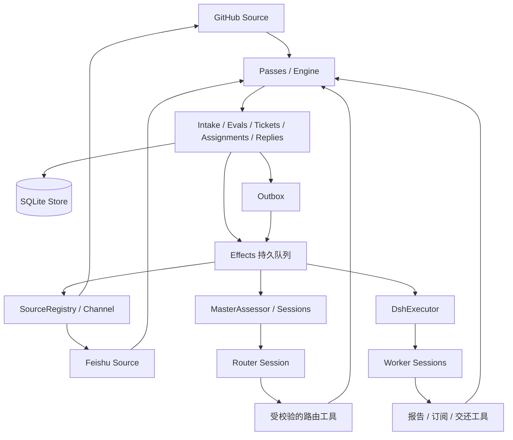
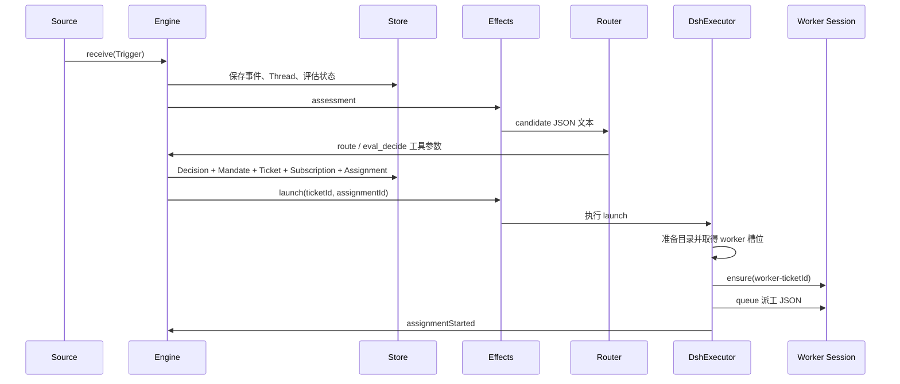
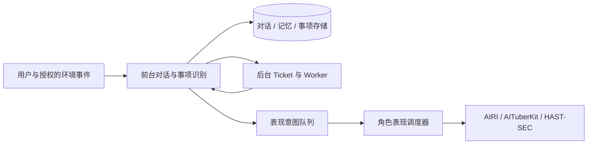

# DeepSeek Super-agent：完整运行机制与实现结构

分析日期：2026-11-03。本文关注实际工程实现，重点是数据结构、模块通信、模型上下文与恢复机制。

## 0. 阅读范围与证据边界

主体源码为 `deepseek-ai/dsh-superagent-prototype`，固定提交：

```text
8c32a9dc5d72c033816c6a8110b37f40cf94fba4
```

底层 Session 与上下文压缩另参考 DeepSeek Harness 官方源码文档，参考提交：

```text
8bd073392eef6f54e921a093b95076248eb08cbb
```

Harness 参考提交用于解释框架机制，不表示该原型在每种部署中都运行这一提交。原型 package.json 的 Harness 开发依赖为 `0.2.1-alpha.2`，peerDependencies 使用兼容范围。

本文没有安装或运行原型，没有连接飞书或启动实际 Worker。结论来自固定源码及官方文档。公开原型不等同于团队内部系统；不将完整设计文章中的 Watchdog、跨设备部署等设想视为本原型已实现的能力。

以下 TypeScript 类型为从源码抽取的关键字段或简化表达，省略部分注释、校验及历史兼容字段。JSON 示例使用示意 ID 和内容，不是运行抓包，也不保证复制后可直接调用。工具调用参数示例与数据库记录、Session 消息正文分开说明。

## 1. 系统究竟是什么

Super-agent 是安装在 DeepSeek Harness 中的插件 bundle。它主要针对一个 GitHub 仓库工作，可以另外监听飞书。

它的工作不是把一个超级提示词发给模型，然后等待模型自行管理所有事情。程序负责确定性状态、授权、订阅、持久化和投递，模型负责语义判断及实际任务执行。

可将其分为四层：

1. **外部渠道层**：GitHub、飞书，产生消息与状态变化，也接收回复。
2. **业务状态层**：Trigger、Thread、Eval、Ticket、Assignment、Subscription、Outbox。
3. **运行适配层**：把业务状态转换为模型输入，把模型工具调用转换为 Engine 命令。
4. **Harness 执行层**：Session、Agent、Inbox、模型调用、工具调用、Shell 与子 Agent。



源码入口：[runtime.ts](https://github.com/deepseek-ai/dsh-superagent-prototype/blob/8c32a9dc5d72c033816c6a8110b37f40cf94fba4/src/app/runtime.ts)、[engine.ts](https://github.com/deepseek-ai/dsh-superagent-prototype/blob/8c32a9dc5d72c033816c6a8110b37f40cf94fba4/src/core/engine.ts)。

## 2. Session、Agent、Thread、Ticket、Assignment 分别是什么

| 概念 | 含义 | 保存什么 | 不代表什么 |
|---|---|---|---|
| Session | 可恢复的模型交互记录 | 用户输入、模型回复、工具结果及执行事件 | 不等于一个飞书话题 |
| Agent | 使用 Session 运行模型和工具的执行对象 | 运行状态、收件箱、工具与运行控制 | 不必拥有独立人格 |
| Router | 主 Session/Agent 承担的调度角色 | 路由判断、任务概览、报告和通知 | 不是另一种底层 Session 存储格式 |
| Worker | 某 Ticket 对应的执行角色 | 该项工作的模型上下文和工具执行 | 不等于 Ticket 本身 |
| Thread | 来源中的讨论流 | 时间线关联、订阅关系、评估缓冲等 | 不装入全部模型思考过程 |
| Ticket | 一项有授权范围的工作 | 来源、派工、输入、待答问题与结束事实 | 不以模型最后一句话作为唯一状态 |
| Assignment | 一次派工实例 | pending/running/ended 及报告 | 不表示每次都创建新 Session |

主 Session ID 从业务状态读取；首次缺省为 `orchestrator-${key(stateDir)}` 并持久化。

Worker Session ID 由 Ticket ID 确定：

```ts
workerSessionId(ticketId) = `worker-${ticketId}`
```

同一 Ticket 重试、恢复或收到后续消息时，通常复用同一 Worker Session。Assignment 可以换，Session ID 不必换。Session 若被外部删除，执行器会尝试重建，不能假定历史始终存在。

Router 和 Worker 共用 Harness Session 机制，通过 preset、提示、工具、模型和目录体现角色差异。不能把它概括成项目额外实现了互不相关的 ChatSession 和 WorkerSession 两套系统。

源码：[sessions.ts](https://github.com/deepseek-ai/dsh-superagent-prototype/blob/8c32a9dc5d72c033816c6a8110b37f40cf94fba4/src/app/sessions.ts)、[dsh.ts](https://github.com/deepseek-ai/dsh-superagent-prototype/blob/8c32a9dc5d72c033816c6a8110b37f40cf94fba4/src/executor/dsh.ts)。

## 3. 核心数据结构

### 3.1 Trigger：不可变的外部事件

```ts
interface ThreadRef { source: string; id: string }
interface ActorRef { source: string; id: string }
interface ChannelRef {
  source: string
  thread: string
  address: Record<string, string>
}

interface Trigger {
  id: string
  source: string
  threads: ThreadRef[]
  actor: ActorRef
  human: boolean
  addressed?: 'mention' | 'direct'
  at: string
  text: string
  channel?: ChannelRef
  url?: string
  meta: Record<string, unknown>
}
```

关键规则：

- 一条 Trigger 至少属于一个 Thread，`threads[0]` 是其主要评估归属。
- `actor`、`human` 和 `addressed` 由 Source 适配器提供，不由模型凭文本自报。
- `text`、`meta` 是外部数据，不能修改系统授权。
- `channel` 是回复地址，`threads` 是读取和路由归属。两者用途不同。
- 一条 Trigger 可以属于多个 Thread，由此产生 correlated 关系，但相关关系本身不负责投递。

来源适配后的示例：

```json
{
  "id": "TRIGGER_ID_EXAMPLE",
  "source": "github",
  "threads": [{ "source": "github", "id": "42" }],
  "actor": { "source": "github", "id": "alice" },
  "human": true,
  "addressed": "mention",
  "at": "2026-11-03T02:00:00.000Z",
  "text": "@agent 请修复登录按钮无响应的问题。",
  "channel": {
    "source": "github",
    "thread": "github:42",
    "address": { "number": "42" }
  },
  "meta": { "number": 42, "isPr": false, "kind": "issue" }
}
```

GitHub 事件通常由 `key(...)` 生成稳定 ID。`key` 对字符串数组 JSON 做 SHA-256，取十六进制前 32 位。同一事件重复读取可去重；评论版本等参与构造时，更新也可以成为新事件。不是简单对正文相同就当作同一消息。

### 3.2 Thread：订阅和评估的一致性边界

```ts
interface Thread {
  key: string
  ref: ThreadRef
  createdAt: string
  lastAt?: string
  subscriptions: string[]
  context?: string[]
  correlated: string[]
  pending: string[]
  evaluating?: Evaluation
  expired?: number
  meta: Record<string, unknown>
}
```

`threadKey(ref)` 是 `${ref.source}:${ref.id}`。在该单仓库部署中，GitHub Issue/PR 号可形成 `github:42`。不能无修改地将这个键设计用于多个仓库，否则不同仓库的同号事项会碰撞。

- `subscriptions`：订阅该 Thread 的 Ticket ID 数组。
- `context`：其中只为背景信息订阅的 Ticket ID。它是 subscriptions 的语义子集，不是另一个消息队列。
- `pending`：等待下一次 Eval 的 Trigger ID 缓冲。
- `evaluating`：当前评估，同一 Thread 最多一个。评估期间到来的事件合并到后续批次。
- `correlated`：共享过事件的其他 Thread，仅供补充上下文。

Thread 不保存全部消息正文数组。正文在 Trigger 中，时间线由关联索引组织。

### 3.3 Mandate：任务被允许做什么

```ts
interface Mandate {
  strength: 'explicit' | 'inferred'
  policyVersion: string
  basis: MandateBasis
  actor: ActorRef
  scope: string
}
```

它记录接受任务的依据、策略版本、发起者和范围。basis 包含直接请求、跟进、准入表、机器人候选等来源依据。

新上下文不自动扩大 Mandate。超出范围的消息需要交还路由，而不是 Worker 自行升级授权。

### 3.4 Ticket：工作状态的业务事实

```ts
interface Ticket {
  id: string
  title: string
  decisionId: string
  mandate: Mandate
  channels: ChannelRef[]
  assignments: Assignment[]
  inputs: TicketInput[]
  undelivered: string[]
  origin: { triggerId: string; triggerIds: string[] }
  execution?: { name: string; directory: string; assignment: string }
  follows?: { thread: string; own: boolean; closed?: unknown }[]
  attention?: { id: string; question: string; triggerId?: string }
  ended?: { at: string; by: 'executor' | 'human'; outcome: string; reason?: string }
  delivery?: { error: string; at: string }
  answers?: string[]
  createdAt: string
  updatedAt: string
}
```

- `channels`：初始接单消息对应的对外回复目的地。
- `origin`：任务从哪些 Trigger 产生，用于追溯。
- `execution.assignment`：实际派给 Worker 的任务文本。
- `inputs`：业务输入记录，不等于模型 Session 历史。
- `undelivered`：其中仍待交付运行中的 Assignment 的 Input ID。
- `follows`：由 Source 绑定并影响任务完成判断的 Issue/PR 等 Thread，不等于任意背景订阅。
- `attention`：结构化待人工问题。
- `ended`：结束事实。不存在即为 open。

Ticket 没有靠单一 `status` 字符串承担所有逻辑。展示状态由派工、报告、待答问题、投递错误和结束事实推导。

### 3.5 Assignment 和 TicketInput

```ts
interface Assignment {
  id: string
  state: 'pending' | 'running' | 'ended'
  createdAt: string
  startedAt?: string
  endedAt?: string
  endedReason?: string
  report?: { state: ReportState; summary: string; at: string }
  deliveredAt?: string
  idleAt?: string
}

type ReportState =
  | 'progress' | 'waiting' | 'ready'
  | 'blocked' | 'failed' | 'dropped'
```

TicketInput 是判别联合，kind 包括 `trigger`、`policy-changed`、`resumed`、`text`、`note`，另保留历史 `reopen` 记录。

消息输入的关键字段：

```ts
type TriggerInput = {
  id: string
  kind: 'trigger'
  triggerId: string
  at: string
  note?: string
  human?: true
  context?: true
  readAt?: string | null
  deliveredTo?: string
  deliveredAt?: string
}
```

`readAt: null` 表示已投递但尚未记录 Session 接收进步骤。某些早期数据没有 readAt，代码保留兼容语义。读取不是模型已理解或任务已完成的证明，而是运行时记录它已进入可供模型读取的步骤。

### 3.6 Evaluation、Decision、Disposition

| 结构 | 主要字段 | 作用 |
|---|---|---|
| Evaluation | id、threadKey、triggerIds、primary、strength、actor、basis、policyVersion、startedAt、delivered、deadline | 对一个 Thread 的一批 Trigger 做判断，记录超时与策略版本 |
| Decision | id、evalId、threadKey、triggerIds、kind、reason、ticketId、mandate、audit | 持久记录判断结果；保留历史 reopen 类型 |
| TriggerDisposition | filtered、evalId、decisionId、fanout、context、handbacks、acked、at | 记录一条事件被过滤、交给哪些任务、由谁决定、是否交还 |

`fanout` 是这条事件已经到达的 Ticket 列表；`subscriptions` 是未来事件的路由关系。二者不能混为一谈。

全部原始类型：[model.ts](https://github.com/deepseek-ai/dsh-superagent-prototype/blob/8c32a9dc5d72c033816c6a8110b37f40cf94fba4/src/core/model.ts)。稳定 ID：[ids.ts](https://github.com/deepseek-ai/dsh-superagent-prototype/blob/8c32a9dc5d72c033816c6a8110b37f40cf94fba4/src/core/ids.ts)。

## 4. 数据怎样落盘

### 4.1 业务状态：SQLite

Runtime 打开 `<stateDir>/orchestrator.sqlite`。表的核心 DDL 如下，省略辅助索引和生成列：

```sql
CREATE TABLE trigger (id TEXT PRIMARY KEY, value TEXT NOT NULL, at TEXT NOT NULL);
CREATE TABLE disposition (id TEXT PRIMARY KEY, value TEXT NOT NULL);
CREATE TABLE thread (key TEXT PRIMARY KEY, value TEXT NOT NULL);
CREATE TABLE ticket (id TEXT PRIMARY KEY, value TEXT NOT NULL);
CREATE TABLE decision (id TEXT PRIMARY KEY, thread TEXT NOT NULL, value TEXT NOT NULL);
CREATE TABLE outbox (id TEXT PRIMARY KEY, value TEXT NOT NULL);
CREATE TABLE trigger_thread (
  thread TEXT NOT NULL, id TEXT NOT NULL, at TEXT NOT NULL, human INTEGER NOT NULL,
  PRIMARY KEY (thread, id)
);
CREATE TABLE effect (
  kind TEXT NOT NULL, key TEXT NOT NULL, value TEXT NOT NULL,
  seq INTEGER NOT NULL, generation INTEGER NOT NULL DEFAULT 0,
  attempts INTEGER NOT NULL DEFAULT 0, error TEXT NOT NULL DEFAULT '',
  due INTEGER NOT NULL, since TEXT NOT NULL,
  PRIMARY KEY (kind, key)
);
CREATE TABLE kv (key TEXT PRIMARY KEY, value TEXT NOT NULL);
```

Thread、Ticket 等对象经 JSON.stringify 保存进 value，读取后 JSON.parse。subscriptions 嵌在 Thread 的 JSON 中，没有独立 subscription 表。

trigger_thread 为事件时间线索引。ticket.open、ticket.active、thread.active 等生成列和索引用来限制扫描范围，不是每一轮把全部历史解码。

数据库配置 WAL 与 `synchronous=FULL`。Engine 用同步事务更新关联状态；Store 还支持提交后动作。它没有为每一个字段建立规范化关系表，而是采用“JSON 聚合对象＋必要的索引”设计。

### 4.2 模型会话：Harness 事件日志

业务 SQLite 不是模型完整对话存储。Session 历史由 Harness 的 Session/Persistence 层维护。

官方 Session 使用 append-only 事件日志，再派生模型可见 messages。官方持久化后端之一是 JSONL，可使用 Zstandard 压缩。持久化后端是可替换接口，不应将 JSONL 说成所有部署唯一后端。

这两套存储通过 Session ID、Ticket ID、Input ID 等关联，不是一个跨数据库原子事务。实现通过先记录、可重试投递、去重和恢复来衔接，不能据此宣称所有外部行为都严格 exactly-once。

来源：[store.ts](https://github.com/deepseek-ai/dsh-superagent-prototype/blob/8c32a9dc5d72c033816c6a8110b37f40cf94fba4/src/app/store.ts)、[Harness Session](https://github.com/deepseek-ai/deepseek-harness/blob/8bd073392eef6f54e921a093b95076248eb08cbb/packages/core/session/README.md)、[Harness Persistence](https://github.com/deepseek-ai/deepseek-harness/blob/8bd073392eef6f54e921a093b95076248eb08cbb/packages/session/session-persistence/README.md)。

## 5. Part 是什么，Part 之间怎么通信

### 5.1 核心 Part 是进程内对象

Engine 构造五个领域 Part：

| Part | 实现职责 | 直接依赖的其他 Part |
|---|---|---|
| Replies | 回复的用途、目的地和允许条件 | 不依赖其他 Part |
| Tickets | 创建、订阅、输入、恢复、结束任务 | Replies |
| Assignments | 派工状态、输入投递/读取、报告 | Tickets、Replies |
| Evals | 批处理、准入、语义决策、超时 | Tickets |
| Intake | 接收去重、Thread 关联、订阅扇出 | Tickets |

它们都继承 EnginePart，持有相同的 repo、policy getter、clock 和外部端口。

通信方式是普通 TypeScript 方法调用。跨 Part 变化由 Engine 开启的同步事务包住。这里不需要每个 Part 一个进程，不通过模型自然语言协调，也不是五个 Agent。

以新事件为例，简化代码：

```ts
Engine.receive(trigger) {
  return repo.atomic(() => intake.receive(trigger))
}

Intake.receive(trigger) {
  // 保存 Trigger，找到订阅任务。
  tickets.addInput(ticket, input)
}
```

### 5.2 外部能力通过 Port 注入

Core 不自己调用模型、Shell 或 GitHub。它依赖接口：

```ts
interface Assessor {
  request(candidate: Candidate): void
  release?(evalId: string): void
}

interface Executor {
  start(ticket: Ticket, assignment: Assignment): void
  deliver(ticket: Ticket, assignment: Assignment): void
  stop(ticket: Ticket, assignment: Assignment, reason: string): void
}

interface Outbox {
  send(message: OutboundMessage): void
  status(id: string): 'pending' | 'sent' | 'dropped' | undefined
  withdraw(id: string): void
}
```

这些方法在 Core 的事务中调用时，主要排入后续工作。异步模型调用与网络操作由适配器执行，结果再通过 Engine.assignmentStarted、inputsDelivered、inputsRead、report 等方法回写。

### 5.3 领域事件与运行时事件不同

Core 可发出以下结构的 DomainEvent：

```json
{
  "type": "thread.subscribed",
  "at": "2026-11-03T02:00:00.000Z",
  "data": { "threadKey": "github:42", "ticketId": "TICKET_ID_EXAMPLE" }
}
```

它经过 EngineOptions.emit 回调通知应用层。它不等于 Harness 的 `session/event`，也不是一套已定义的跨主机消息协议。

应用层另外监听 Cordis/Harness 运行事件，例如 `agent/status`、`agent/error`、`agent/inbox/claimed`、`session/event`，用于把模型运行事实映射回业务状态。

来源：[engine.ts](https://github.com/deepseek-ai/dsh-superagent-prototype/blob/8c32a9dc5d72c033816c6a8110b37f40cf94fba4/src/core/engine.ts)、[part.ts](https://github.com/deepseek-ai/dsh-superagent-prototype/blob/8c32a9dc5d72c033816c6a8110b37f40cf94fba4/src/core/part.ts)、[ports.ts](https://github.com/deepseek-ai/dsh-superagent-prototype/blob/8c32a9dc5d72c033816c6a8110b37f40cf94fba4/src/core/ports.ts)。

## 6. 全部通信通道速查

| 起点 → 终点 | 方式 | 数据格式 | 可靠性归属 |
|---|---|---|---|
| GitHub/飞书 → Source | 来源轮询、事件消费及 CLI/来源适配 | 来源原生消息，随后转换 Trigger | Source 游标、补拉、Trigger 去重 |
| Source → Engine | SourceContext.receive / Passes.receive 方法 | Trigger 对象 | Engine 事务 |
| Core Part → Core Part | 同步方法调用 | TypeScript 类型对象 | 外层 Engine 事务 |
| Core → Assessor/Executor/Outbox | Port 方法 | Candidate、Ticket、Assignment、OutboundMessage | 适配器记录 Effects 或回执 |
| 应用异步工作 → Effects | SQLite 队列 | kind/key/value JSON | 重试、顺序、generation |
| Assessor → Router | Harness Inbox | kind=candidate 的 JSON 文本 | Session 消息 ID 与投递去重 |
| Router → Engine | 模型工具调用 | Zod 校验后的 JSON 参数 | 主机校验＋事务 |
| Executor → Worker | queue / steer | 派工或 Trigger 卡片 JSON 文本 | Input 队列＋Harness Inbox |
| Worker → 业务状态 | orchestrator_report 等工具 | JSON 参数 | 工具约束＋Engine 事务 |
| Worker 状态 → Router | relay / notice effect | worker_report、worker_attention、follow_up 等 JSON 文本 | 持久队列与去重 |
| Router/Worker → 外部渠道 | 工具申请回复，再经 Outbox/Channel | OutboundMessage | 回执、重试、目的地校验 |
| 管理面板 → 应用 | 本机管理 HTTP API | API 契约对象 | 路由校验、同源限制 |

没有一个“所有 Part 通信都遵循”的万能 JSON envelope。这里至少有业务对象、Effects payload、模型输入卡片、模型工具参数、对外回复和管理 API 六类格式。

## 7. Effects：异步通信的持久底座

### 7.1 六种效果及真实 payload

```ts
interface EffectPayloads {
  assessment: { triggerId: string }
  launch: { ticketId: string; assignmentId: string }
  delivery: { ticketId: string }
  relay: { text: string }
  notice: { value: Record<string, unknown>; summary: string }
  reply: Record<string, never>
}
```

reply 的 payload 是空对象，因为消息正文已保存在 Outbox receipt 中，effect.key 即消息 ID。

例如一个投递请求在数据库中的核心字段：

```json
{
  "kind": "delivery",
  "key": "TICKET_ID_EXAMPLE",
  "value": "{\"ticketId\":\"TICKET_ID_EXAMPLE\"}",
  "seq": 18,
  "generation": 0,
  "attempts": 0,
  "error": "",
  "due": 1793671200000,
  "since": "2026-11-03T02:00:00.000Z"
}
```

注意 value 在 SQLite 中是 JSON 字符串，而 handler 收到的是 JSON.parse 后的对象。

### 7.2 执行与合并

`enqueue(kind, key, payload)` 写入 effect 表，主键为 `(kind, key)`。相同键仍在队列中时更新 payload、增加 generation、重置失败与 due，并保留原队列位置。这是合并待处理工作，不是为每次 enqueue 永久保留一个独立事件。

Handler 注册后，由调度器按照 due、seq、并发上限选择运行。

任务成功后，DELETE 条件匹配 kind、key、seq、generation。旧尝试执行期间若同键 payload 已更新，旧尝试不能误删新版本。

失败使用指数退避。默认从 2 秒增长至 60 秒，不同 kind 可覆盖；reply 使用 5 秒至 300 秒。Later 表示暂时不能执行，例如暂停或没有槽位，只推迟，不计入失败。

`relay` 和 `notice` 配置 ordered，按各自队列顺序处理；早期失败会阻挡该 kind 的后续项。这不表示系统所有任务共享一个全局顺序。

### 7.3 谁负责推动队列

Passes 每 2 秒请求一轮，同时在新事件、工具调用及配置变化后触发即时轮次。并发请求合并为一次后续轮次，避免多个评估泵同时修改状态。

Effects.enqueue 本身也 kick 一个微任务启动分发。事务在同一同步调用栈完成，外部异步执行发生在提交以后。不能在事务中等待模型或网络。

来源：[effects.ts](https://github.com/deepseek-ai/dsh-superagent-prototype/blob/8c32a9dc5d72c033816c6a8110b37f40cf94fba4/src/app/effects.ts)、[passes.ts](https://github.com/deepseek-ai/dsh-superagent-prototype/blob/8c32a9dc5d72c033816c6a8110b37f40cf94fba4/src/app/passes.ts)。

## 8. 订阅怎样建立和投递

### 8.1 订阅存储

订阅是 Thread.subscriptions 中的 Ticket ID，建立时做包含检查再保存。其语义是“这个 Thread 的后续事件送到这个 Ticket”，而不是让模型在脑中记住关注某话题。

建立方式包括：

1. Tickets.create 自动订阅接受批次中 Trigger 所属的 Thread。
2. Engine.attach 把明确关联的消息交给已有 Ticket，并订阅其 Thread。
3. Worker 的 orchestrator_thread_follow 工具建立背景订阅。
4. GitHub Source 绑定任务自己的 PR 等 Thread。

Worker 建立背景订阅的工具参数：

```json
{
  "thread": "github:57",
  "reason": "这个 Issue 说明同一登录故障的复现条件。"
}
```

ticketId 不由模型任意指定，而由注册该 Worker 工具时捕获的 Ticket 绑定。这样 Worker 不会通过这个工具把其他 Ticket 随意订阅到 Thread。

### 8.2 Intake 的 fan-out

收到 Trigger 后的顺序：

1. 规范化时间戳，检查 threads 非空。
2. 按 Trigger ID 去重。
3. 检查 Source 监听范围。被过滤的事件也记录 disposition。
4. 保存 Trigger，更新 Thread.lastAt、correlated。
5. 遍历每个 Thread.subscriptions，装入按 Ticket ID 去重的 Map。
6. 根据任务存活状态、human、context-only 等条件筛选。
7. 对每个到达的 Ticket 调用 addInput，保存 trigger 引用。
8. 保存 disposition.fanout 和 context。
9. 没有 Worker 拥有处理权的消息进入 Eval；尝试唤醒符合条件的历史 Ticket。

一条消息属于多个 Thread，又都订阅了 Ticket A，也不会因此给 A 生成多份同一输入。

### 8.3 三种关系不能混淆

| 关系 | 后续事件投递 | 是否拥有人的跟进消息 | 是否直接影响 PR 完成判断 |
|---|---|---|---|
| 普通订阅 | 符合条件时投递 | 可以 | 不一定 |
| context-only 订阅 | 作为背景投递 | 不因此获得 | 不自动影响 |
| correlated | 不负责路由 | 不获得 | 不影响 |

Source 绑定到 ticket.follows 的关系另外参与完成判断。

### 8.4 任务结束之后

- 正常结束的 Ticket 保留订阅；自己 Thread 上的人类新消息可以在原授权仍有效时恢复它。
- 机器人、CI 消息不自动恢复已结束任务。
- context-only Thread 上的人类消息也不因此恢复它。
- 人明确停止的 Ticket 不再接收后续工作，不能自动恢复。
- 暂停、授权重验证和等待人工还会进一步限制启动。

已分派到任务的人的跟进由 Worker 判断：范围内继续，超出范围则交还。它交还之前 Router 不能再次接受同一消息为一项重复工作，停止请求有专门处理路径。

来源：[intake.ts](https://github.com/deepseek-ai/dsh-superagent-prototype/blob/8c32a9dc5d72c033816c6a8110b37f40cf94fba4/src/core/intake.ts)、[tickets.ts](https://github.com/deepseek-ai/dsh-superagent-prototype/blob/8c32a9dc5d72c033816c6a8110b37f40cf94fba4/src/core/tickets.ts)。

## 9. Router 如何接到任务，又怎样作出决定

### 9.1 两级判断

Gate 是程序规则：身份、是否直接请求、准入表、主动模式、策略版本等。

Assessment 是模型语义判断：事件是否满足主动规则、是否重复、是否值得处理等。它不能越过 Gate 扩大权限。

主动模式为 off、observe、auto。observe 的积极判断只记录 would accept，不实际接单；明确授权请求在各模式下仍能工作。

### 9.2 Candidate 投递

Assessor.request 将 `{ triggerId }` 放入 assessment effect，key 为 evalId。Handler 重新核对当前 Eval，再向主 Session 投递 JSON 文本，顶层包含 `kind: "candidate"` 和候选卡片字段。

候选卡片是有限内容的模型视图，不是把数据库全部对象直接塞入提示。模型能通过 orchestrator_eval、orchestrator_eval_read 或通用资源读取工具补读上下文。

候选成功投递以后，才记录 candidateDelivered 并开始计该 Eval 的有效等待时间，避免队列等待消耗研判时间。

### 9.3 明确请求使用的路由工具

工具名：`orchestrator_route`。以下为 accept 参数示例：

```json
{
  "decisions": [
    {
      "kind": "accept",
      "trigger_id": "TRIGGER_ID_EXAMPLE",
      "title": "修复登录按钮无响应",
      "worktree_name": "fix-login-button",
      "acknowledgement": "我会排查登录按钮并提交修复供你检查。"
    }
  ]
}
```

同一工具还支持 attach、stop、ignore。一次 1–20 项，每一项作为自己的 Engine 命令处理，某项被拒绝不回滚其他已成功项。返回 results，元素包含对应 trigger_id、kind，以及结果或 refused 原因。

### 9.4 主动接受使用完整研判工具

工具名：`orchestrator_eval_decide`，在读取对应评估上下文后调用。关键字段为：

```ts
{
  trigger_id: string
  decision: 'accept' | 'ignore' | 'unavailable'
  rule_assessments: RuleAssessment[]
  direction: AdmissionDirection
  title: string
  worktree_name?: string
  scope: string
  intent_evidence?: string | null
  acknowledgement?: string | null
  reason: string
}
```

rule_assessments 和 direction 还有各自校验规则，此处不伪造可直接执行的嵌套值。明确候选与主动候选不能随意互换工具绕过判断。

来源：[assessment.ts](https://github.com/deepseek-ai/dsh-superagent-prototype/blob/8c32a9dc5d72c033816c6a8110b37f40cf94fba4/src/app/assessment.ts)、[main.ts](https://github.com/deepseek-ai/dsh-superagent-prototype/blob/8c32a9dc5d72c033816c6a8110b37f40cf94fba4/src/app/tools/main.ts)、[policy.ts](https://github.com/deepseek-ai/dsh-superagent-prototype/blob/8c32a9dc5d72c033816c6a8110b37f40cf94fba4/src/policy.ts)。

## 10. 从接单到 Worker 启动



prepare 命令可以创建 git worktree。每项 Ticket 有目录，但目录不是强安全隔离。Worker 使用操作者 OS 权限执行工具，命令包装和工作目录默认值不能代替沙箱。

Worker 槽位用于限制并发，准备目录和启动期间也占位。对已有任务的人类跟进或状态请求留有额外槽位路径，避免新任务把人的跟进永远堵在后面。

初次派工的消息正文示例：

```json
{
  "ticket_id": "TICKET_ID_EXAMPLE",
  "title": "修复登录按钮无响应",
  "assignment": "排查并修复登录按钮无响应，验证后提交结果。",
  "trigger": {
    "trigger_id": "TRIGGER_ID_EXAMPLE",
    "from": "alice",
    "thread": "github:42",
    "at": "2026-11-03T02:00:00.000Z",
    "text": "@agent 请修复登录按钮无响应的问题。"
  }
}
```

assignment 超过 1500 字符时，卡片带 assignment_chars 和 assignment_read。单 Trigger 正文超过 600 字符时提供截取与 `trigger/<id>` 读取路径。上述字段来自卡片封装，不是完整 Trigger 的原始字段名：例如 from 对应 actor.id。

再次派工且 Session 已有初次任务时，消息可缩减为：

```json
{
  "ticket_id": "TICKET_ID_EXAMPLE",
  "assignment": 2
}
```

此处 assignment 是派工次数数字，初次卡片中 assignment 是任务文本字符串；它们是不同分支构造出的模型消息正文，不能误当一个始终同型的网络 DTO。

## 11. Worker 输入和 Session 收件箱

### 11.1 addInput 到 deliverInput

Tickets.addInput 先按 Input ID 去重，写入 inputs。可以自动处理时再写 undelivered，保存后调用 Executor.deliver 或 start；等待人工期间的自动消息可只记录而不唤醒。

deliver 的作用是 enqueue `delivery` effect。Handler 逐条重新读取任务，确认任务未结束、Assignment 未被替换，再投递。实际输入根据 kind 变成 Trigger JSON、策略说明或文字通知。

普通 Trigger 卡片正文如下：

```json
{
  "trigger_id": "FOLLOWUP_TRIGGER_ID_EXAMPLE",
  "from": "alice",
  "thread": "github:42",
  "at": "2026-11-03T02:05:00.000Z",
  "text": "补充：只有移动端会出现。",
  "context": true
}
```

context=true 仅在背景订阅时出现。路由说明、来源链接、被回复消息预览等是可选字段。超长输入还会在外层进一步限长，并附 `ticket/<id>/input/<key>` 路径。

### 11.2 三种投递方式

| Sessions.prompt 模式 | 调用 Agent 的方法 | 意图 |
|---|---|---|
| queue | followup | 进入后续回合输入路径 |
| steer | steer | 供运行中的后续步骤接收新输入 |
| inject 对象 | inject | 注入带摘要标签的通知，不立即唤醒 |

AgentDelivery 会检查 nextTurn、nextStep 收件箱以及持久化历史，并使用稳定消息 ID 去重。重复尝试不会仅因为进程重启就生成新的身份。

包裹后的消息在模型消息层使用 `role: "user"`，正文是 text block；source 元数据标记为 `kind: "dsh-superagent"`，而非真正人的 source。role=user 只是模型输入角色，不代表这条自动通知拥有人的授权。

### 11.3 四个不同阶段

```text
业务保存 Input
  -> 投递到 Session 收件箱
  -> Session 接纳输入进入步骤并记录历史
  -> Worker 报告处理结果
```

执行器通过 session/event 中对应 user/message 记录 inputsRead。仅出现 agent/inbox/claimed 还不足以断言输入已进历史，取消可能发生在两者之间。

来源：[delivery.ts](https://github.com/deepseek-ai/dsh-superagent-prototype/blob/8c32a9dc5d72c033816c6a8110b37f40cf94fba4/src/app/delivery.ts)、[sessions.ts](https://github.com/deepseek-ai/dsh-superagent-prototype/blob/8c32a9dc5d72c033816c6a8110b37f40cf94fba4/src/app/sessions.ts)、[dsh.ts](https://github.com/deepseek-ai/dsh-superagent-prototype/blob/8c32a9dc5d72c033816c6a8110b37f40cf94fba4/src/executor/dsh.ts)。

## 12. Worker 如何汇报、提问和交还

### 12.1 报告工具

工具名：`orchestrator_report`。参数示例：

```json
{
  "state": "ready",
  "summary": "已修复移动端登录点击问题，相关测试通过，PR 可供审核。",
  "pr_number": 43
}
```

这只是格式示例，不是本次实际创建过 PR。主机还会读取并校验所报 PR 的归属，不能任意填一个 PR 就宣称交付。

其他可选字段：

| 字段 | 含义 |
|---|---|
| human_action | 需要人回答的一项具体问题；null 清除已有问题，省略则保留 |
| question_for_trigger_id | 问题由哪条人类输入引起 |
| reply_to_trigger_id | 当前报告回答哪条人类问题 |

工具接受 progress、ready、blocked、failed、dropped。waiting 通常由执行器从运行结束情况产生，不是此工具开放的枚举值。

工具将外部下划线字段转成内部 WorkerReport：question、askedBy、answers 等；再调用 Engine.report。需要时同步 enqueue relay，确保业务报告与待转交工作一起记录。

### 12.2 发往 Router 的结果格式

```json
{
  "kind": "worker_report",
  "ticket": {
    "ticket_id": "TICKET_ID_EXAMPLE",
    "title": "修复登录按钮无响应",
    "state": "person/review",
    "strength": "explicit",
    "read": "ticket/TICKET_ID_EXAMPLE"
  },
  "trigger_id": "TRIGGER_ID_EXAMPLE",
  "state": "ready",
  "summary": "已修复并验证，等待审核。",
  "read": "ticket/TICKET_ID_EXAMPLE/result"
}
```

ticket 是受限卡片投影，示例省略了可选元数据。summary 超过 600 字符时截取，并给出 chars 和 read。不是所有卡片都由模型总结。

普通 progress 且没有回答特定问题时，不转发给 Router，留在 Ticket 内部。若有待人工问题，生成 `kind: "worker_attention"`；需要 Router 获取完整问题时再按资源读取。

### 12.3 交还超出范围的消息

Worker 调用 `orchestrator_trigger_handback`：

```json
{
  "trigger_id": "FOLLOWUP_TRIGGER_ID_EXAMPLE",
  "reason": "这条消息要求增加第三方登录，超出当前修复范围。"
}
```

系统记录 handbacks。若还有其他 Worker 拥有这条人的消息，暂不新建 Eval；没有所有者后，才重新交给 Router。这样避免 Router 与 Worker 同时对一条跟进各开一个任务。

### 12.4 Worker 也能发确认

Worker 的 orchestrator_ack 可以申请给原始请求发确认。它仍经过 Engine 的回复规则和 Outbox，不是随意直连飞书。因此“Worker 永远不能回复任何人”是不准确的；结果和人工问题通常由 Router 统一处理，受限确认等有专门通道。

来源：[executor tools](https://github.com/deepseek-ai/dsh-superagent-prototype/blob/8c32a9dc5d72c033816c6a8110b37f40cf94fba4/src/app/tools/executor.ts)、[assignments.ts](https://github.com/deepseek-ai/dsh-superagent-prototype/blob/8c32a9dc5d72c033816c6a8110b37f40cf94fba4/src/core/assignments.ts)、[notices.ts](https://github.com/deepseek-ai/dsh-superagent-prototype/blob/8c32a9dc5d72c033816c6a8110b37f40cf94fba4/src/app/notices.ts)。

## 13. 怎样回复到原渠道

Router 调用 orchestrator_reply，例如：

```json
{
  "ticket_id": "TICKET_ID_EXAMPLE",
  "purpose": "result",
  "text": "登录按钮问题已修复，PR #43 可供检查。"
}
```

purpose 可以是 answer、result、attention。attention 必须对应当前待人工问题，不能借它发送任意进度消息。不同用途决定引用哪条原始消息及目的地。

内部回复对象：

```ts
interface OutboundMessage {
  id: string
  channel: ChannelRef
  text: string
  kind: 'acknowledgement' | 'reply' | 'notice'
  ticketId?: string
}
```

Outbox 原子保存 receipt 并 enqueue reply effect。外发时根据 ChannelRef 选择 GitHub/飞书发送器。来源关闭时等待；目标已删除或不再允许发送时记 dropped。

同一 Ticket、同一对话的后续消息通常等待前一消息发送，但前项连续失败达到阈值时允许后续继续。不同 Ticket 不因为这种会话内约束互相永久阻挡。

receipt 状态为 pending、sent、dropped。超时后对外平台实际已收到、但本地尚未登记成功的极端情形仍需渠道幂等支持或状态核对，不能用本地去重推导“外部平台绝不重复发”。

来源：[replies.ts](https://github.com/deepseek-ai/dsh-superagent-prototype/blob/8c32a9dc5d72c033816c6a8110b37f40cf94fba4/src/core/replies.ts)、[outbox.ts](https://github.com/deepseek-ai/dsh-superagent-prototype/blob/8c32a9dc5d72c033816c6a8110b37f40cf94fba4/src/app/outbox.ts)。

## 14. 长会话与上下文如何维护

### 14.1 完整历史与本次模型输入分离

Harness Session 将模型可见事实记录到 append-only 事件日志，再通过 deriveMessages 派生当前消息。压缩、替换、提示变化都应能通过日志重建。

事件日志不等于每次请求完整携带的历史。Model-visible surface 是一个可压缩的投影。

### 14.2 局部上下文，按需读取

Router 默认获得候选卡片、任务卡片、结果短文，不自动拥有全部 Worker 历史。需要时调用 orchestrator_read 读取：

```text
trigger/<id>
thread/<key>
ticket/<id>
ticket/<id>/assignment
ticket/<id>/inputs
ticket/<id>/result
ticket/<id>/transcript
ticket/<id>/message/<n>
```

transcript 视图先列预览与单条资源路径，再按需读具体消息。该视图会省略流式碎片、用量及 reasoning 等内容，不能当成对底层 Session 日志所有事件的无损导出。

Worker 的资源读取受自身 Ticket 和可达 Trigger 限制，不具有与 Router 完全相同的全局查询能力。

### 14.3 旧历史压缩

原型的 Router 和 Worker preset 都挂载 compaction-basic、command-compact 和 tool-result-pruner。

基本过程为：检测上下文压力；在适用时裁剪超大工具结果；将旧的完整区段总结为摘要；保留近期尾部；记录替换和摘要事件。原始日志仍保留。

具体 token 阈值依赖所安装 Harness 版本与配置，不能从 Super-agent 的业务对象推导一个固定的“记忆长度”。

### 14.4 Prompt 与任务授权分开

每次模型请求读取当前 Prompt 配置版本，组合角色、团队说明、环境和策略。Worker 再附加自己的 Mandate。Session 保存使用过的版本记录，便于追溯。

提示词可以改变模型行为，但不能越过代码实施的准入、工具参数与用途校验。

来源：[resources.ts](https://github.com/deepseek-ai/dsh-superagent-prototype/blob/8c32a9dc5d72c033816c6a8110b37f40cf94fba4/src/app/resources.ts)、[context.ts](https://github.com/deepseek-ai/dsh-superagent-prototype/blob/8c32a9dc5d72c033816c6a8110b37f40cf94fba4/src/app/context.ts)、[cordis.patch.yml](https://github.com/deepseek-ai/dsh-superagent-prototype/blob/8c32a9dc5d72c033816c6a8110b37f40cf94fba4/cordis.patch.yml)、[Harness compaction](https://github.com/deepseek-ai/deepseek-harness/blob/8bd073392eef6f54e921a093b95076248eb08cbb/packages/compaction/compaction-basic/README.md)。

## 15. 非阻塞、并发和后台任务

原型给 Router/Worker 设置专用 preset：前台 Shell 命令超过约 5 秒转后台，工具等待也受限制。Router 还有不等待的指令与 guard，防止它通过 sleep 或长等待占住路由步骤。

这不表示单个模型请求执行过程中能无限并发处理另一轮请求。异步的关键在于：事件先存储进入 Inbox，耗时工具移到后台，后续运行步骤再接收新输入。

任务回合结束但仍有后台 Shell/子 Agent 时，通常继续占 Worker 槽位，不立即报告 waiting。完成事件唤醒同一任务。后台工作有时限，超限清理并保存结果供后续读取。

人工交接时槽位可释放，供其他工作使用；某些供审核的后台服务可以继续，但不应据此认为任何进程都永久运行。替换 Assignment、停止和重启都走清理路径。

来源：[dsh.ts](https://github.com/deepseek-ai/dsh-superagent-prototype/blob/8c32a9dc5d72c033816c6a8110b37f40cf94fba4/src/executor/dsh.ts)、[background.ts](https://github.com/deepseek-ai/dsh-superagent-prototype/blob/8c32a9dc5d72c033816c6a8110b37f40cf94fba4/src/executor/background.ts)。

## 16. 任务何时结束，何时恢复

主要展示状态包括 working/queued、working、idle、person/answer、person/review、person/blocked、person/failed、person/delivery，以及结束结果。

几个容易误解的规则：

- ready 不一定等于 Ticket 结束。存在仍打开的跟随 PR 时，通常是等待审核。
- dropped 表示不再需要处理，不必制造一条无用回复。
- failed/blocked 后自动反馈可以被记录，但不自动把任务不断重启；需要人、重试或后续有效报告解除等待。
- 正常完成后，人的范围内跟进可以恢复同一 Ticket。
- 人明确停止与普通完成不同，原 Mandate 被撤回，不能自动恢复。
- 新 Policy 不粗暴取消所有在途工作；变化作为 Input 告知，恢复历史任务时再检查授权依据是否有效。

来源：[stage.ts](https://github.com/deepseek-ai/dsh-superagent-prototype/blob/8c32a9dc5d72c033816c6a8110b37f40cf94fba4/src/core/stage.ts)、[tickets.ts](https://github.com/deepseek-ai/dsh-superagent-prototype/blob/8c32a9dc5d72c033816c6a8110b37f40cf94fba4/src/core/tickets.ts)。

## 17. 崩溃恢复具体依靠什么

| 风险点 | 对应机制 | 实际保证的边界 |
|---|---|---|
| 来源重复拉到消息 | 稳定 Trigger ID | 同 ID 在业务入口去重 |
| 状态已保存、任务尚未启动就退出 | 事务中的 launch effect | 重启后继续尝试启动 |
| 同一个投递被重试 | 稳定消息 ID＋历史/Inbox 检查 | 避免重复注入同一逻辑输入 |
| 输入已投递但尚未进入步骤 | readAt / deliveredTo 记录 | 替换派工时能重新排队未取走的输入 |
| 运行中的 effect 被新 payload 更新 | generation 比对 | 旧尝试不误删新任务 |
| Worker 进程重启 | Session 恢复＋新 Assignment＋恢复说明 | 检查现场后继续，不保证所有外部操作可自动判定 |
| 外发回复失败 | Outbox receipt＋重试 | 记录 pending/sent/dropped；渠道边界仍需幂等处理 |
| 模型/网络短暂失败 | 有限次数退避重试 | 不将一切失败都无限重试 |

恢复说明要求 Worker 先核对工作目录、Git 历史与 GitHub 状态，再继续，避免盲目重做已完成操作。

系统通过多处幂等键、事务和恢复检查降低重复和遗漏，而不是声称存在跨 SQLite、Harness、操作系统与 GitHub 的全局事务。

## 18. 一个完整例子：从请求到跟进再到交付

1. 用户在 GitHub #42 @机器人，请它修登录故障。
2. Source 生成 Trigger A，归属 github:42，带 actor、human、addressed 和 channel。
3. Engine 在事务里存事件、时间线和待评估状态，发起候选判断。
4. Router 调用 route 接受明确请求。主机校验后创建 Decision、Mandate、Ticket T、Assignment A1 和 Thread 订阅。
5. launch effect 准备工作目录，创建或恢复 worker-T，queue 初始派工。
6. Worker 用工具读代码、改文件、测试。执行日志留在自己的 Session 中。
7. 用户在 #42 补充“仅移动端”。Intake 按订阅将新 Trigger 变成 T 的 Input，不要求重新 @。
8. delivery effect 将补充通过 steer 送入 worker-T。Router 得到 follow_up 通知，知道该消息由 Worker 决定，不再重复开单。
9. Worker 如果发现消息要求新增整个第三方登录，会 handback。没有其他所有者后再由 Router 判断是否开新 Ticket。
10. 修复后 Worker 创建并报告 PR #43。Source/工具验证关联，将其加入任务 follows 和订阅。
11. Worker 报告 ready，Router 获取 worker_report，按需读取完整结果，再通过 reply 工具请求发送结果。
12. Outbox 持久化回复并交由 Channel 发回原对话。Ticket 因 PR 未关闭保持等待审核。
13. PR 评审和 CI 事件继续投递给 Worker；PR 合并且不存在未完成跟进时，Ticket 结束。
14. 以后用户在原 Thread 补充范围内问题，正常结束的 T 可以按规则恢复，同一 worker-T 继续使用原历史。

## 19. 对陪伴 AI 的迁移设计：哪些可复用，哪些要重做

本节是基于实现的建议，不是 DeepSeek 已提供的陪伴功能。

可复用：稳定事项 ID、事件日志、结构化状态、持久投递、任务级 Session、按需读取上下文，以及输入和授权分离。

需要重做的领域规则：

- 陪伴前台不宜是纯路由器，还要负责自然对话和角色一致性。
- 不应把整段私人聊天无差别广播到所有后台任务。可以在前台建立话题/事项关联，再明确投递。
- 任务结束和“关系记忆”是两件事。用户偏好、重要经历、承诺和授权需要独立模型，不能只依赖压缩摘要。
- 角色表现应由单独调度器管理，任务 Worker 只提交表现意图，不能各自直接抢占嘴型、表情和手势。
- 主动关心要有时机、频率、冷却和用户偏好规则，不宜照搬工程场景的接单触发条件。

一种可迁移结构：



## 20. 实现时最容易犯的错误

1. 将 Thread、Ticket、Session 当成同一个 ID，使跨渠道、多任务或恢复无法表达。
2. 只持久化 messages，不记录授权、任务状态和待投递操作。
3. 在数据库事务内等待模型和网络，阻塞全部任务。
4. 只在内存里订阅，重启后丢失路由关系。
5. 通过主题相似度直接扩大权限，或把 context-only 消息当作新指令。
6. 用 free text 猜测“等待人”，而不保存结构化 Attention。
7. 把收件箱已收到当作模型已读，把已读当作完成。
8. 将局部去重误认为跨外部系统的 exactly-once。
9. 每次跟进都创建新 Worker，丢掉任务内上下文。
10. Router 携带所有 Worker 的全部日志，最终重新变成一个拥挤的大 Session。

## 21. 源码导航与核查顺序

建议按照下面顺序读代码，所有链接都固定到本文主体提交。

| 顺序 | 文件 | 先看什么 |
|---|---|---|
| 1 | [model.ts](https://github.com/deepseek-ai/dsh-superagent-prototype/blob/8c32a9dc5d72c033816c6a8110b37f40cf94fba4/src/core/model.ts) | Trigger、Thread、Ticket、Input、Assignment |
| 2 | [ports.ts](https://github.com/deepseek-ai/dsh-superagent-prototype/blob/8c32a9dc5d72c033816c6a8110b37f40cf94fba4/src/core/ports.ts) | Core 与外部实现之间的接口 |
| 3 | [engine.ts](https://github.com/deepseek-ai/dsh-superagent-prototype/blob/8c32a9dc5d72c033816c6a8110b37f40cf94fba4/src/core/engine.ts) | 事务边界和各 Part 的协作 |
| 4 | [intake.ts](https://github.com/deepseek-ai/dsh-superagent-prototype/blob/8c32a9dc5d72c033816c6a8110b37f40cf94fba4/src/core/intake.ts) | receive、fan-out、follow-up 归属 |
| 5 | [tickets.ts](https://github.com/deepseek-ai/dsh-superagent-prototype/blob/8c32a9dc5d72c033816c6a8110b37f40cf94fba4/src/core/tickets.ts) | subscribe、addInput、wake、handback |
| 6 | [evals.ts](https://github.com/deepseek-ai/dsh-superagent-prototype/blob/8c32a9dc5d72c033816c6a8110b37f40cf94fba4/src/core/evals.ts) | 批处理、Gate 和 Decision |
| 7 | [effects.ts](https://github.com/deepseek-ai/dsh-superagent-prototype/blob/8c32a9dc5d72c033816c6a8110b37f40cf94fba4/src/app/effects.ts) | 异步队列、重试和 generation |
| 8 | [assessment.ts](https://github.com/deepseek-ai/dsh-superagent-prototype/blob/8c32a9dc5d72c033816c6a8110b37f40cf94fba4/src/app/assessment.ts) | candidate 到 Router 的投递 |
| 9 | [dsh.ts](https://github.com/deepseek-ai/dsh-superagent-prototype/blob/8c32a9dc5d72c033816c6a8110b37f40cf94fba4/src/executor/dsh.ts) | Worker 启动、投递和生命周期 |
| 10 | [sessions.ts](https://github.com/deepseek-ai/dsh-superagent-prototype/blob/8c32a9dc5d72c033816c6a8110b37f40cf94fba4/src/app/sessions.ts) | Session 复用、prompt、preset |
| 11 | [delivery.ts](https://github.com/deepseek-ai/dsh-superagent-prototype/blob/8c32a9dc5d72c033816c6a8110b37f40cf94fba4/src/app/delivery.ts) | Inbox 与历史去重 |
| 12 | [main tools](https://github.com/deepseek-ai/dsh-superagent-prototype/blob/8c32a9dc5d72c033816c6a8110b37f40cf94fba4/src/app/tools/main.ts)、[executor tools](https://github.com/deepseek-ai/dsh-superagent-prototype/blob/8c32a9dc5d72c033816c6a8110b37f40cf94fba4/src/app/tools/executor.ts) | 模型工具参数和真实字段 |
| 13 | [outbox.ts](https://github.com/deepseek-ai/dsh-superagent-prototype/blob/8c32a9dc5d72c033816c6a8110b37f40cf94fba4/src/app/outbox.ts)、[registry.ts](https://github.com/deepseek-ai/dsh-superagent-prototype/blob/8c32a9dc5d72c033816c6a8110b37f40cf94fba4/src/sources/registry.ts) | 对外发送、来源与渠道 |
| 14 | [store.ts](https://github.com/deepseek-ai/dsh-superagent-prototype/blob/8c32a9dc5d72c033816c6a8110b37f40cf94fba4/src/app/store.ts)、[resources.ts](https://github.com/deepseek-ai/dsh-superagent-prototype/blob/8c32a9dc5d72c033816c6a8110b37f40cf94fba4/src/app/resources.ts) | 存储与按需上下文 |

本文验证范围：已核对核心类型、关键方法、Effects 格式、Router/Worker 工具参数和 preset 配置。未验证真实模型执行质量、网络故障下的所有交错情况或生产部署稳定性。
